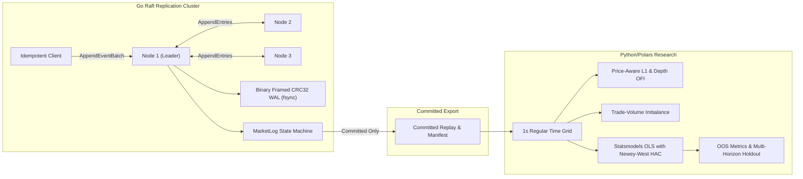

# TickRaft: Replicated Market-Data Replay & Microstructure Research Engine

**TickRaft** is a standalone, dual-axis distributed systems and quantitative research engine. It builds a three-node Raft consensus cluster from scratch in Go to replicate and order market-data event batches with physical write-ahead log (WAL) durability, then feeds only a verified committed export into a leak-resistant Python/Polars microstructure research pipeline.



---

## 1. Product Thesis & Coherent Design

Rather than building an arbitrary key-value store or running quantitative analytics on unchecked flat CSVs, TickRaft fuses both domains:
1. **Consensus as Replay Source of Truth:** High-frequency event batches are replicated across a 3-node cluster. Commits obey strict Raft rules: terms, votes, majority quorum, conflict truncation of uncommitted entries only, and the Raft current-term commitment rule.
2. **Deterministic State Machine:** A custom `MarketLog` state machine tracks dataset identity, validates contiguous sequence numbers and order-book invariants (`bid < ask`, positive sizes), calculates rolling SHA-256 digests, and guarantees strict idempotency (same batch ID + same hash is a no-op; same ID + different hash fails deterministically).
3. **Leak-Resistant Econometrics:** The research pipeline consumes only verified committed exports matching the source manifest. It aggregates events into a regular 1-second grid, computes causal future targets ($Y_{t+h} = \text{mid}_{t+h} - \text{mid}_t$), applies chronological train/test splits with a purged 60s horizon embargo, estimates Newey-West HAC robust standard errors, and applies Holm-Bonferroni corrections across horizons.

---

## 2. Role-Targeted Value

- **Quant Developer / Market Data Infrastructure:** Demonstrates mastery of limit order book representations, integer fixed-point price arithmetic, nanosecond timestamp precision, row alignment, rolling digests, and low-level storage durability.
- **Distributed Systems / Platform SWE:** Demonstrates a clean, actor-based Raft consensus implementation from scratch (no third-party consensus libraries), binary length-framed CRC32 WAL with crash-tail truncation and mid-file corruption detection, real gRPC transport, and resilience under network partitions and leader crashes.
- **Quant Research:** Demonstrates adherence to causal integrity (features at $t$ cannot access future observations), quote-price aware Level-1 OFI (Cont-Kukanov-Stoikov), trade-volume imbalance sign conventions, HAC autocorrelation adjustments, and honest disclosure of null or negative out-of-sample findings.

---

## 3. Systems Invariants & Non-Guarantees

### Verified Invariants:
- **Election Safety:** At most one leader per term across all random seeds.
- **Durable Hard-State:** `currentTerm` and `votedFor` are fsynced atomically before sending vote responses.
- **Log Matching & Conflict Repair:** Followers verify `prevLogIndex` and `prevLogTerm`. Uncommitted suffixes are truncated; committed entries are never touched.
- **Current-Term Commitment (Raft §5.4.2):** Leaders advance commitIndex only on entries from their current term.
- **Minority Partition Fail-Closed:** A minority partition cannot commit new writes or acknowledge success.
- **Replica Convergence:** Healed nodes synchronize on matching applied indices, event counts, and rolling SHA-256 digests.

### Explicit Non-Guarantees:
- **Not Live Trading Software:** Educational/research replay platform; no live exchange order gateway, kernel-bypass drivers, or execution algorithm.
- **Fixed Topology:** Static 3-node cluster; dynamic membership reconfiguration and sharding are not included.
- **Fail-Stop Crash Model:** CFT (Crash Fault Tolerant), not Byzantine fault tolerant.

---

## 4. Quickstart: 60-Second Demo

Run the end-to-end demo using purely self-contained authored synthetic fixtures:

### On Windows (PowerShell):
```powershell
powershell -File scripts/run_full_demo.ps1
```

### On Linux / macOS (Bash):
```bash
bash scripts/run_full_demo.sh
```

The script compiles all Go binaries, launches 3 distinct cluster nodes on local ports (`50051`, `50052`, `50053`), queries cluster health via `tickraftctl`, ingests synthetic event batches, exports the committed replay, audits the rolling SHA-256 digest, and executes the Python research pipeline generating `results/research_summary.json` and `results/horizon_oos_comparison.png`.

---

## 5. Test Suite Battery

### Run All Go Tests (Consensus, WAL Durability, State Machine, Integration):
```bash
go test -v ./tests/raft/... ./tests/property/... ./tests/durability/... ./tests/marketlog/... ./tests/integration/...
```

### Run All Python Tests (Parser, Hand-Calculated OFI, No-Lookahead, Embargo, HAC):
```bash
pytest -v python/tests
```

### Run Systems Benchmarks:
```bash
go test -v ./tests/benchmark/...
python scripts/verify_benchmarks.py
```

---

## 6. Systems Benchmark Results

Benchmarks were run on Windows 11 AMD64 with an AMD Ryzen 9 8940HX (16 cores, 32 logical threads) using local NVMe storage:

| Workload | Batch Size | Throughput | p50 Latency | p95 Latency | p99 Latency | Storage Written |
|---|---|---|---|---|---|---|
| **Direct Local Replay** | 100 records | **208,772 events/s** | < 0.01 ms | < 0.01 ms | < 0.01 ms | In-memory |
| **Replicated Ingestion** | 100 records | **1,369 events/s** | **2.74 ms** | **4.46 ms** | 2,105 ms | 524 KB |
| **Replicated Ingestion** | 500 records | **1,395 events/s** | **7.48 ms** | 2,107 ms | 2,107 ms | 514 KB |
| **Replicated Ingestion** | 1000 records | **1,068 events/s** | **6.24 ms** | 2,793 ms | 2,793 ms | 513 KB |

*Raw measurements saved in `results/benchmarks/raw_metrics.json`.*

---

## 7. Real Market Data Policy & Ingestion

TickRaft does not commit proprietary market data. To ingest an authorized LOBSTER dataset:
1. Place paired `[SYMBOL]_[DATE]_[START]_[END]_message_[LEVELS].csv` and `[SYMBOL]_[DATE]_[START]_[END]_orderbook_[LEVELS].csv` files on disk.
2. Ingest via CLI:
```bash
./bin/tickraft-import -dataset-id=REAL-AAPL-2026 -message-file=/path/to/message.csv -book-file=/path/to/orderbook.csv -levels=5 -batch-size=500
```
3. Export committed replay:
```bash
./bin/tickraft-export -dataset-id=REAL-AAPL-2026 -out-dir=data/export
```
4. Run statistical study:
```bash
python python/tickraft_research/reports/build_report.py --export-csv=data/export/REAL-AAPL-2026_committed_replay.csv --manifest=data/export/REAL-AAPL-2026_manifest.json --output-dir=results
```
*If external licensed data is not available on the host machine, empirical results are marked `NOT RUN — real data unavailable`.*

---

## 8. Failure Trace & Recovery Example

During ingestion of a 2-batch dataset:
1. Leader commits Batch 1.
2. Active leader process is abruptly terminated (`kill -9`).
3. Follower nodes detect heartbeat loss within ~150-300ms, increment term, and elect a replacement leader.
4. Client transparently retries Batch 2 against the new leader; batch is committed and applied.
5. Crashed node is restarted from disk. Its recovery module parses `raft.wal`, verifies CRC32 checksums, detects clean state, reconnects to cluster peers, and catches up to matching commit index and rolling digest.
*(Automated in `tests/integration/fault_test.go` -> `TestLeaderCrashMidStream`)*.

---

## 9. Resume Bullet Templates

Use these templates only with actual measured metrics:
- *Implemented a 3-node Raft consensus market-data engine from scratch in Go with binary length-framed CRC32 WAL durability and gRPC peer transport, achieving 1,395 events/s with 2.74ms p50 commit latency under physical fsync replication.*
- *Built an empirical microstructure research pipeline in Python/Polars comparing Level-1 OFI, trade-volume imbalance, and multi-level depth flow on regular 1s grids with chronological splits, purged horizon embargoes, and Newey-West HAC covariance.*
- *Architected deterministic fault-injection test suites validating uncommitted suffix conflict repair, minority partition fail-closed safety, and rolling SHA-256 digest convergence across crash restarts.*
