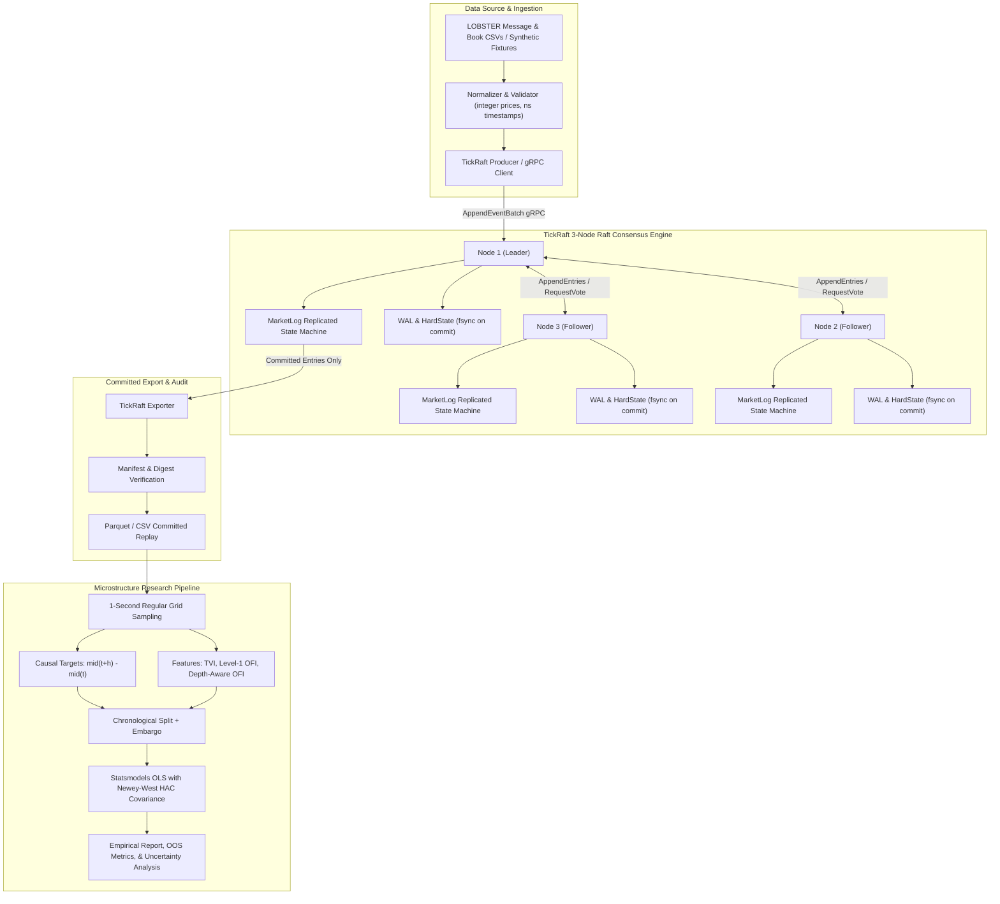

# TickRaft System Architecture

## 1. High-Level Overview

TickRaft is a coherent, fault-tolerant market-data replay engine and microstructure research platform. It integrates a distributed Raft consensus core in Go with a high-throughput, leak-resistant empirical microstructure analysis pipeline in Python.

---

## 2. Distributed Consensus Layer (Raft in Go)

### 2.1 State Representation
Each Raft node maintains:
- **Persistent State:**
  - `currentTerm uint64`: latest term node has seen (initialized to 0 on first boot).
  - `votedFor string`: candidateId that received vote in current term (empty if none).
  - `log []LogEntry`: log entries containing `{Index uint64, Term uint64, Command []byte}`.
- **Volatile State:**
  - `commitIndex uint64`: index of highest log entry known to be committed.
  - `lastApplied uint64`: index of highest log entry applied to state machine.
  - `role Role`: Follower, Candidate, or Leader.
  - `currentLeader string`: address/ID of current perceived leader.
- **Leader Volatile State:**
  - `nextIndex map[string]uint64`: index of next log entry to send to each peer.
  - `matchIndex map[string]uint64`: index of highest log entry known to be replicated on peer.

### 2.2 Concurrency Architecture
To guarantee race freedom under `go test -race`, each node runs a single serialized actor event loop:
- Messages from RPC handlers (`RequestVote`, `AppendEntries`, client proposals) are posted into typed Go channels.
- Timers (heartbeat interval and randomized election timeouts) trigger events via channel tickers.
- State mutation occurs exclusively within the actor loop, eliminating multi-mutex lock-order hazards.

---

## 3. Storage Layer: WAL & HardState

- **Hard-State Persistence:** `currentTerm` and `votedFor` are written to a dedicated hard-state file using atomic temp-file write, fsync, and atomic rename.
- **Write-Ahead Log (WAL):**
  - Binary framing: `[RecordLength: 4B uint32][RecordType: 2B][CRC32: 4B uint32][Payload: N bytes]`.
  - Durability: Entries are written and fsynced to disk prior to acknowledging successful replication to peers or clients.
  - Crash Recovery: Reads sequential records until EOF. Validates CRC32. A corrupted or partially written tail is truncated per documented recovery policy. A corruption in the middle of the WAL halts startup loudly to avoid silent data truncation.

---

## 4. Replicated State Machine: MarketLog

The state machine interprets log entries strictly in commit order:
1. `BeginDataset(dataset_id, manifest_hash, schema_version, expected_count)`: Initializes dataset session.
2. `AppendEventBatch(batch_id, seq_start, seq_end, payload_hash, events, book_snapshots)`:
   - Validates sequence continuity (`seq_start == last_applied_seq + 1`).
   - Checks idempotency cache: if `batch_id` was already applied with the same `payload_hash`, it succeeds idempotently without re-applying.
   - If `batch_id` matches an existing record but `payload_hash` differs, it returns a deterministic conflict error.
   - Updates rolling SHA-256 digest over normalized event rows.
3. `FinalizeDataset(dataset_id, expected_count, expected_digest)`:
   - Verifies that all expected events were applied sequentially without gaps.
   - Asserts computed rolling digest matches `expected_digest`.

---

## 5. Microstructure Research Pipeline

- **Ingestion & Normalization:** Converts prices to integer units and timestamps to integer nanoseconds. Validates paired message and book rows.
- **Time Grid Regularization:** Aggregates high-frequency events into fixed 1-second interval buckets. Price at bucket end is the last observed mid-price.
- **Target Construction:** Forward mid-price change $Y_{t+h} = \text{mid}_{t+h} - \text{mid}_t$ for $h \in \{1, 5, 10, 30, 60\}$ seconds.
- **Features:**
  - Trade-Volume Imbalance (TVI): Signed execution volume according to aggressor side.
  - Level-1 OFI: Order Flow Imbalance accounting for price movements at best bid and ask (Cont-Kukanov-Stoikov).
  - Multi-Level Depth OFI: Per-level flow vector across top $L=5$ book levels.
- **Statistical Inference:**
  - Chronological train/test split.
  - Purged embargo period ($= \max(h)$) between train and test sets to eliminate label overlap leakage.
  - OLS regression with Newey-West HAC robust standard errors to correct for serial autocorrelation.
  - Holm-Bonferroni correction for multi-horizon hypothesis testing.
